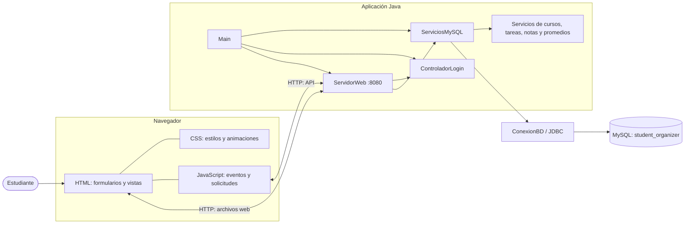
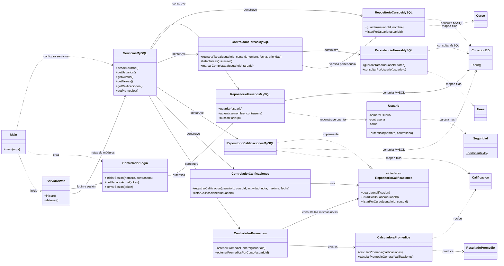
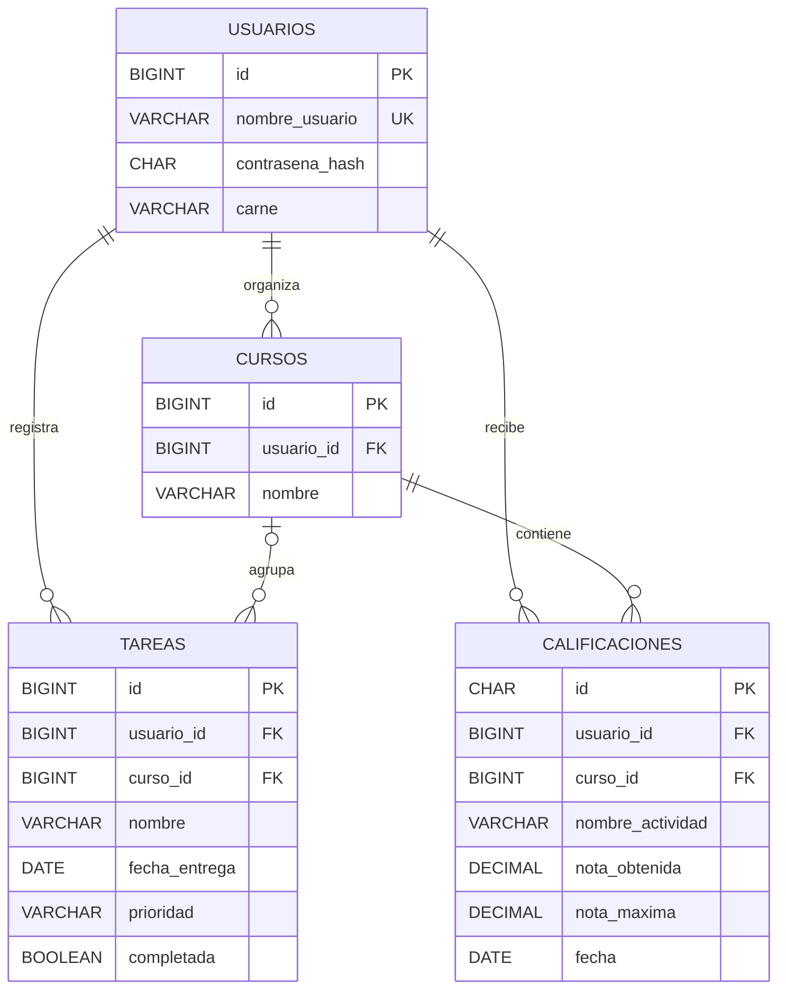

# Arquitectura y UML de Student Organizer

Este documento describe la estructura que está implementada actualmente. Los diagramas están escritos en Mermaid; GitHub los muestra directamente al abrir este archivo.

## 1. Arquitectura general

La aplicación tiene una interfaz web estática, un servidor Java que sirve los archivos y atiende la API, y una base MySQL. El navegador nunca se conecta directamente a la base.



### Responsabilidades

| Parte | Responsabilidad | Archivos de referencia |
|---|---|---|
| Interfaz | Presenta las pantallas y recoge acciones del usuario. | `src/main/resources/public/` |
| JavaScript | Valida campos básicos, llama la API y actualiza la pantalla. | `src/main/resources/public/js/` |
| Servidor | Sirve la interfaz y conecta las rutas HTTP con los servicios Java. | `src/main/java/servidor/ServidorWeb.java` |
| Servicios | Construye y comparte repositorios y controladores usando la configuración MySQL. | `src/main/java/persistencia/ServiciosMySQL.java` |
| Controladores | Aplican la lógica de cada requisito. | `src/main/java/controlador/` y `src/main/java/modulos/` |
| Persistencia | Ejecuta consultas SQL y convierte filas en objetos Java. | `src/main/java/persistencia/` y los repositorios de cada módulo |
| Base de datos | Conserva usuarios, cursos, tareas y calificaciones. | `sql/` |

`ServiciosMySQL.desdeEntorno()` requiere `DB_PASSWORD` y usa `DB_HOST` para elegir el servidor; si no se configura, conecta a `127.0.0.1`. La conexión JDBC usa el puerto `3307` y la base `student_organizer`.

## 2. Diagrama UML de clases

El diagrama muestra las clases principales y sus dependencias. No enumera todos los métodos auxiliares.



### Cómo leerlo

- `Main` prepara los servicios, crea `ControladorLogin` y levanta `ServidorWeb`.
- `ServidorWeb` recibe solicitudes y delega el trabajo; no contiene las consultas SQL de cada repositorio.
- `ServiciosMySQL` centraliza la conexión y construye los servicios compartidos por los módulos.
- El promedio no se guarda en una tabla aparte: se calcula a partir de las calificaciones consultadas.

## 3. Secuencia de inicio de sesión

```mermaid
sequenceDiagram
    actor Estudiante
    participant UI as index.html y app.js
    participant Server as ServidorWeb
    participant Auth as ControladorLogin
    participant Repo as RepositorioUsuariosMySQL
    database DB as MySQL

    Estudiante->>UI: Escribe usuario y contraseña
    UI->>UI: Comprueba que los campos no estén vacíos
    UI->>Server: POST /api/login
    Server->>Auth: iniciarSesion(usuario, contrasena)
    Auth->>Repo: autenticar(usuario, contrasena)
    Repo->>DB: Busca usuario y contrasena_hash
    DB-->>Repo: ID y hash guardado, si existe
    Repo->>Repo: Calcula SHA-256 y compara hashes

    alt Credenciales correctas
        Repo-->>Auth: ID del usuario
        Auth->>Repo: buscarPorId(ID)
        Repo->>DB: Recupera datos de la cuenta
        DB-->>Repo: Fila del usuario
        Repo-->>Auth: Usuario
        Auth->>Auth: Genera token y crea sesión
        Auth-->>Server: Token de sesión
        Server-->>UI: Mensaje correcto y cookie HttpOnly
        UI->>UI: Muestra resultado y abre dashboard.html
    else Credenciales incorrectas
        Repo-->>Auth: Resultado vacío
        Auth-->>Server: Sin token
        Server-->>UI: Mensaje de acceso incorrecto
        UI->>Estudiante: Muestra el error
    end
```

El controlador mantiene las sesiones en memoria y las vence después de 30 minutos sin actividad. La cookie contiene el token; la contraseña no se guarda en texto normal. En esta entrega se usa SHA-256, sin sal. Para un sistema de producción se recomienda un algoritmo de contraseñas con sal y factor de costo.

## 4. Secuencia de registro

```mermaid
sequenceDiagram
    actor Estudiante
    participant UI as index.html y app.js
    participant Server as ServidorWeb
    participant User as Usuario
    participant Repo as RepositorioUsuariosMySQL
    database DB as MySQL

    Estudiante->>UI: Completa usuario, contraseña y carné
    UI->>UI: Comprueba que los tres campos estén completos
    UI->>Server: POST /api/usuarios
    Server->>User: Crea Usuario con los datos recibidos
    User->>User: Seguridad.codificar(contrasena)
    Server->>Repo: guardar(usuario)
    Repo->>DB: INSERT en usuarios
    DB-->>Repo: ID generado
    Repo-->>Server: ID de la cuenta
    Server-->>UI: Confirmación o mensaje de error
```

## 5. Modelo relacional de MySQL



`TAREAS.curso_id` admite `NULL` para conservar tareas antiguas; el código exige curso al registrar tareas nuevas. Las claves compuestas de tareas y calificaciones aseguran que el curso asociado pertenezca al mismo usuario. El diagrama se basa en `sql/esquema.sql` y sus migraciones.

## 6. Rutas y archivos principales

| Ruta | Uso |
|---|---|
| `src/main/java/Main.java` | Punto de entrada; configura e inicia el servidor. |
| `src/main/java/servidor/ServidorWeb.java` | API HTTP y entrega de recursos web. |
| `src/main/java/persistencia/ServiciosMySQL.java` | Configuración y construcción de servicios. |
| `src/main/java/controlador/ControladorLogin.java` | Autenticación y sesiones. |
| `src/main/java/persistencia/RepositorioUsuariosMySQL.java` | Registro y consultas de usuarios. |
| `src/main/java/modulos/Cursos/` | Cursos y consultas MySQL. |
| `src/main/java/modulos/tareas/` | Modelo, controlador y persistencia de tareas. |
| `src/main/java/modulos/calificaciones/` | Calificaciones y su repositorio MySQL. |
| `src/main/java/modulos/promedio/` | Cálculos a partir del repositorio de calificaciones. |
| `src/main/resources/public/` | HTML, CSS y JavaScript del navegador. |
| `sql/` | Esquema y migraciones de MySQL. |

## 7. Endpoints registrados

| Ruta | Función |
|---|---|
| `/api/login` | Iniciar sesión. |
| `/api/usuarios` | Registrar una cuenta. |
| `/api/logout` | Cerrar sesión. |
| `/api/cursos` y `/api/cursos/detalle` | Crear, listar y consultar cursos. |
| `/api/tareas` y `/api/tareas/completar` | Crear, listar y completar tareas. |
| `/api/calificaciones` | Registrar y consultar calificaciones. |
| `/api/promedios` | Calcular promedios con las calificaciones disponibles. |
| `/` | Servir los archivos de `src/main/resources/public/`. |

Las rutas se registran en `ServidorWeb.iniciar()`. Las operaciones que requieren una cuenta usan la sesión recibida en la cookie.
